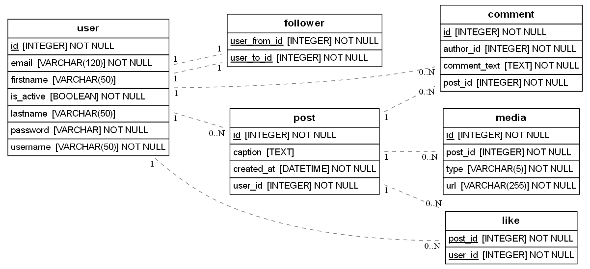

# Modelo de Datos de Instagram

Modelo de base de datos que replica la estructura de Instagram, construido con **Python**, **Flask** y **SQLAlchemy**. Proyecto del bootcamp Full Stack de 4Geeks Academy.



## Tablas

Todos los modelos están en [`src/models.py`](src/models.py).

### User
Usuarios de la plataforma.

| Campo | Tipo | Descripción |
|---|---|---|
| `id` | Integer (PK) | Identificador único |
| `username` | String(50), único | Nombre de usuario |
| `firstname` | String(50), opcional | Nombre |
| `lastname` | String(50), opcional | Apellido |
| `email` | String(120), único | Correo electrónico |
| `password` | String | Contraseña (nunca se serializa) |
| `is_active` | Boolean | Si la cuenta está activa |
| `bio` | String(150), opcional | Descripción del perfil |
| `profile_picture` | String(255), opcional | URL de la foto de perfil |

### Post
Publicaciones de los usuarios.

| Campo | Tipo | Descripción |
|---|---|---|
| `id` | Integer (PK) | Identificador único |
| `user_id` | Integer (FK → user) | Autor del post |
| `caption` | Text, opcional | Texto de la publicación |
| `created_at` | DateTime | Fecha de publicación (se asigna automáticamente) |

### Media
Fotos y vídeos de cada post (un post puede tener varios, como un carrusel).

| Campo | Tipo | Descripción |
|---|---|---|
| `id` | Integer (PK) | Identificador único |
| `type` | Enum (`image` / `video`) | Tipo de archivo |
| `url` | String(255) | Enlace al archivo |
| `post_id` | Integer (FK → post) | Post al que pertenece |

### Comment
Comentarios en los posts.

| Campo | Tipo | Descripción |
|---|---|---|
| `id` | Integer (PK) | Identificador único |
| `comment_text` | Text | Contenido del comentario |
| `author_id` | Integer (FK → user) | Quién lo escribió |
| `post_id` | Integer (FK → post) | En qué post está |

### Like
"Me gusta" de los usuarios en los posts.

| Campo | Tipo | Descripción |
|---|---|---|
| `user_id` | Integer (PK, FK → user) | Quién dio like |
| `post_id` | Integer (PK, FK → post) | A qué post |

### Follower
Quién sigue a quién.

| Campo | Tipo | Descripción |
|---|---|---|
| `user_from_id` | Integer (PK, FK → user) | El usuario que sigue |
| `user_to_id` | Integer (PK, FK → user) | El usuario seguido |

## Relaciones

| Relación | Tipo | Implementación |
|---|---|---|
| User → Post | Uno a muchos | `post.user_id` |
| Post → Media | Uno a muchos | `media.post_id` |
| User → Comment | Uno a muchos | `comment.author_id` |
| Post → Comment | Uno a muchos | `comment.post_id` |
| User ↔ Post (likes) | Muchos a muchos | Tabla intermedia `Like` |
| User ↔ User (seguidores) | Muchos a muchos autorreferencial | Tabla intermedia `Follower` |

- **Uno a muchos:** la tabla "hija" guarda una clave foránea hacia la "padre". Por ejemplo, cada post guarda el `user_id` de su autor, y desde un usuario se accede a sus posts con `user.posts`.
- **Like:** usa una clave primaria compuesta (`user_id` + `post_id`), así que un usuario no puede dar like dos veces al mismo post.
- **Follower:** las dos columnas apuntan a la tabla `user`. Si el usuario 1 sigue al 2 se guarda `(1, 2)`; que el 2 siga al 1 es otra fila distinta, igual que en Instagram. Desde un usuario se accede a `user.following` (a quién sigue) y `user.followers` (quién le sigue).

> Nota: en el diagrama, las líneas de `follower` aparecen como "1 – 1" porque sus claves foráneas también forman la clave primaria. Conceptualmente la relación es muchos a muchos.

## Instalación y uso

```bash
pipenv install    # instalar dependencias
pipenv shell      # entrar al entorno virtual
```

### Generar el diagrama

```bash
python src/models.py
```

Esto genera (o actualiza) el archivo `diagram.png` en la raíz del proyecto a partir de los modelos definidos en `src/models.py`.

### Migraciones

Cada vez que cambies los modelos:

```bash
pipenv run migrate   # crear la migración
pipenv run upgrade   # aplicarla a la base de datos
```

## Tecnologías

- Python 3
- Flask
- SQLAlchemy / Flask-SQLAlchemy
- Flask-Admin
- ERAlchemy2 (generación del diagrama)
